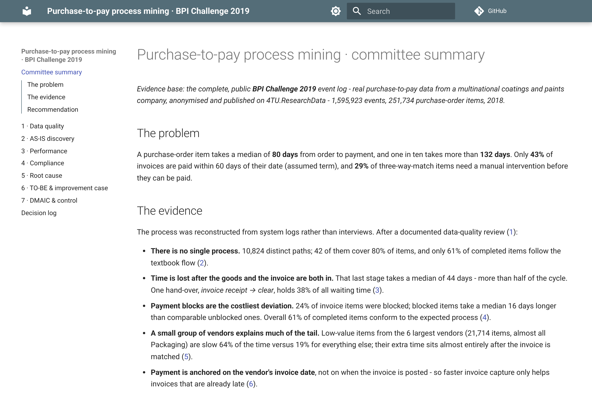
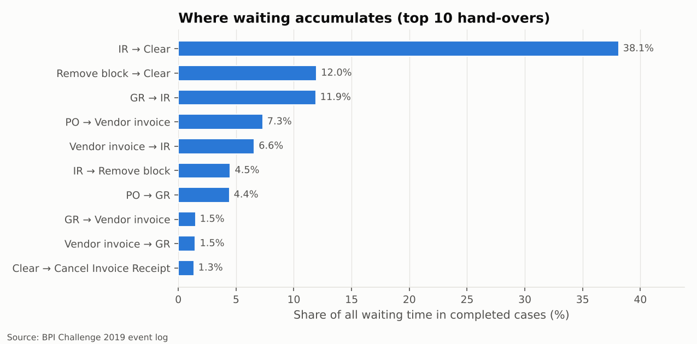
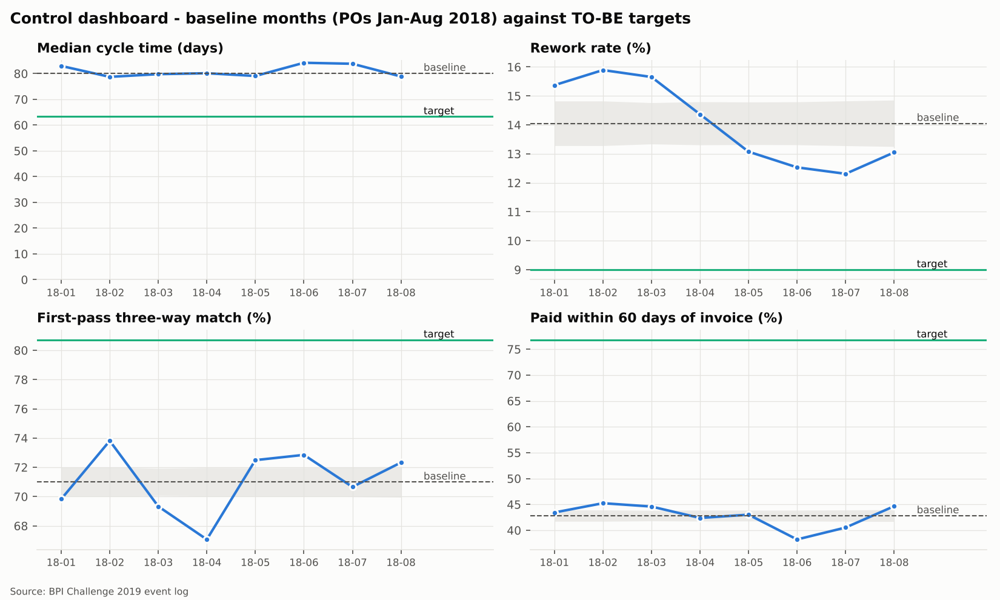
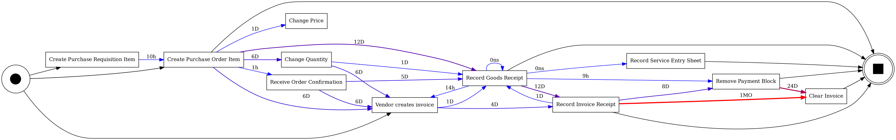

# Purchase-to-pay process mining on real data (BPI Challenge 2019)

[](https://github.com/juansanchezalcantara20-ai/p2p-process-mining/actions/workflows/ci.yml)
· **Report:** <https://juansanchezalcantara20-ai.github.io/p2p-process-mining/>

Discovering the real purchase-to-pay process from **1.6 million system events** instead of
interviews - then measuring where time is lost, checking compliance, finding root causes and
building a TO-BE with a quantified, assumption-explicit improvement case (DMAIC).

## Executive summary

Data: the public BPI Challenge 2019 log - real, anonymised P2P data from a multinational
company, **1,595,923 events / 251,734 purchase-order items** (2018), verified against the
published fingerprint.

| | Finding |
| --- | --- |
| **Problem** | A PO item takes a median **80 days** from order to payment (P90 132). Only **43%** of invoices are paid within 60 days of their date (assumed term); **29%** of three-way-match items need manual intervention before payment. |
| **No single process** | 10,824 variants; 42 cover 80% of items; only **61%** of completed items follow the textbook flow. |
| **Bottleneck** | The stage *after* goods and invoice are both in takes a median **44 days** - over half of the cycle. *Invoice receipt → clear* alone holds **38%** of all waiting time. |
| **Compliance** | **61%** of completed items conform to the expected model. Payment blocks are the highest-impact deviation (24% of invoice items, +16 median days vs comparable items). The system-enforced GR-based invoice check has zero breaches - controls that rely on people are the weak ones. |
| **Root cause** | Low-value items from the **6 largest vendors** (21.7k items, Packaging) are slow 64% of the time vs 19% for the rest; their extra time sits after matching. |
| **Non-obvious insight** | Payment is anchored on the **vendor's invoice date**, not the posting date - so faster invoice capture only helps invoices that are already late. A naive e-invoicing business case would overstate its impact ~2.5×. |
| **Recommendation** | TO-BE with auto three-way match and tolerance-based release, e-invoicing, contract prices in the PO, self-billing for high-volume low-value lines, "no PO, no pay". **Estimated** effect if all levers deliver as assumed: median cycle 80 → ~63 days, first-pass match 71% → ~81%. *Estimates from 2018 data under written assumptions - not achieved savings.* |



| Where waiting accumulates | Control dashboard (DMAIC) |
| --- | --- |
|  |  |



## The seven phases

| Phase | Question | Output |
| --- | --- | --- |
| 1 · [Data quality](docs/01-data-quality.md) | Can we trust the log? | Fingerprint check, timestamp / duplicate / ordering / label / completeness checks, cleaning trail |
| 2 · [AS-IS discovery](docs/02-discovery.md) | How does the process really run? | DFG (frequency + time), variant coverage, happy path vs reality, Inductive Miner → BPMN |
| 3 · [Performance](docs/03-performance.md) | Where is time lost, for whom? | Censoring-safe cycle time, stage decomposition, waiting Pareto, segments (category, spend area, vendor) |
| 4 · [Compliance](docs/04-conformance.md) | Are controls followed? | 7 P2P rules ranked by impact, normative BPMN per category, token replay + alignments |
| 5 · [Root cause](docs/05-root-cause.md) | What goes with slow / deviating items? | Lift tables, depth-3 decision trees in plain language, hotspot profile |
| 6 · [TO-BE](docs/06-to-be.md) | What should change first, and how much would it help? | TO-BE BPMN, 6 prioritised levers each with impact + written assumption, what-if simulation |
| 7 · [DMAIC](docs/07-dmaic.md) | How is it run and controlled? | Define-Measure-Analyze-Improve-Control, KPI dashboard with p-chart limits, control plan |

Every judgement call is in [`docs/DECISIONS.md`](docs/DECISIONS.md).

## Run it

Requires Python ≥ 3.11 and Graphviz (`apt install graphviz` / `brew install graphviz`).

```bash
make install
```

```bash
make all        # downloads + verifies the log (~37 MB), runs all phases (~4 min), builds the site
```

```bash
make sample     # same pipeline on the versioned 1% stratified sample (~15 s, no download)
```

```bash
make test lint
```

`make all` is the single command that reproduces every number, figure, BPMN file and report
page; nothing in `docs/` is typed by hand. The 1% sample (2,517 items) reproduces the headline
figures within a few percent of the full run, which is also a check on the stratified sampling.

```
src/p2pmining/   ingest · quality · discovery · performance · conformance · rootcause · tobe · report
data/sample/     1% stratified sample in the original CSV layout (raw data is never committed)
results/         aggregated results (CSV / JSON) of the full run
models/          AS-IS (Inductive Miner), normative and TO-BE models - BPMN and PNML
docs/            MkDocs report (published to GitHub Pages) + decision log
tests/           pytest suite on synthetic logs with known, injected problems
```

## What this demonstrates

| What process roles ask for | Where it is in this repo |
| --- | --- |
| **Process mining** (event logs, discovery, variants) | Phase 2 - DFG, variant analysis, Inductive Miner with fitness/precision trade-off made explicit |
| **AS-IS / TO-BE mapping, BPMN** | `models/as_is_inductive_core.bpmn`, `models/normative_*.bpmn`, `models/to_be.bpmn` |
| **Bottleneck analysis** | Phase 3 - stage decomposition, waiting Pareto, medians/P90 with censoring handled |
| **Conformance checking / internal control** | Phase 4 - three-way match, invoice-before-GR, post-PO changes, payment blocks, maverick buying; token replay and alignments |
| **Root-cause analysis** | Phase 5 - interpretable trees and lifts explained in business language |
| **Lean Six Sigma, DMAIC, continuous improvement** | Phases 6-7 - prioritised levers, SIPOC, CTQs, control plan, p-chart dashboard |
| **Data quality before analysis** | Phase 1 - fingerprinting, cleaning trail, every rule justified |
| **Python / SQL engineering** | pm4py, DuckDB, pandas, scikit-learn; pytest, ruff, GitHub Actions, one-command reproducibility |
| **Honest business cases** | Every impact figure carries its assumption; the e-invoicing estimate was corrected when the data contradicted the naive version |

## How this was built

I built this repository by directing **Claude Code** (an AI coding agent) in a single working
session: I defined the goal, the phases, the quality bar and the rules (public data only,
everything reproducible, no impact figure presented as an achieved saving), and the agent
wrote the code, ran the analysis and drafted the report under those constraints. Every
judgement call it made is logged with its reasoning in [`docs/DECISIONS.md`](docs/DECISIONS.md),
and the findings were checked against the data rather than taken on trust. The methodological
choices - censoring-safe cohorts, separating order-time attributes from process behaviour,
capping the e-invoicing estimate once the data showed payment is anchored on the invoice
date - are the process-analysis judgement this repository is meant to show.

## Scope & limitations

* **Data source.** The official host (4TU.ResearchData) was unreachable from the build
  environment, so the log was obtained from a public GitHub mirror of its CSV export. The file
  matches the published event and case counts exactly and the download is SHA-256 pinned;
  placing the official XES in `data/raw/` makes the pipeline use it instead.
* **One company, one year (2018), anonymised.** Findings describe that organisation; the
  *method* is what transfers.
* **No amounts per document, no due dates, no costs.** Three-way match is checked on sequence,
  not on amounts; on-time payment uses an assumed 60-day term (sensitivity shown); impact is
  expressed in case-days, not money.
* **Date-only timestamps** for vendor invoices and requisitions limit precision to days.
* **Right censoring.** Durations use POs created Jan-Aug 2018 only; later orders had not
  finished when the data was extracted.
* **Associations, not causation.** Root-cause results say where to look and which hypotheses
  to test with the process owner.
* **Impact figures are estimates** derived from the AS-IS data under explicit assumptions
  (avoidable shares, payment term, peer comparisons). None is a realised saving. The largest
  one (self-billing for six vendors) is zero if their long payment time is contractual.
* **Effort ratings** in the prioritisation are judgement, labelled as such.
* BPMN files are regenerated on every run and receive fresh internal element IDs, so they show
  up as changed in git even when the model is identical.

## Data citation

van Dongen, B.F. (2019). *BPI Challenge 2019*. 4TU.ResearchData.
<https://doi.org/10.4121/uuid:d06aff4b-79f0-45e6-8ec8-e19730c248f1>

Code: MIT licence. pm4py is used as an unmodified dependency (AGPL-3.0).
