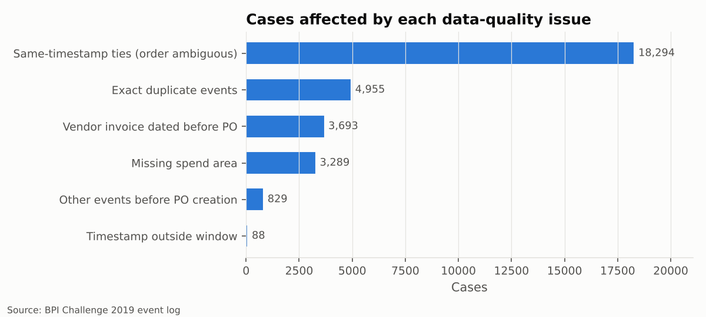

# 1 · Data quality: question the log before using it

> **Why this comes first.** A process-mining result is only as trustworthy as the event log
> behind it. Before drawing a single map we check timestamps, duplicates, ordering, labels
> and completeness, and we write down every cleaning decision.

## Fingerprint

The loaded log has **1,595,923 events** in **251,734 cases** (one case = one
purchase-order item). The publication reports 1,595,923 events and
251,734 cases, so the file matches the published figures exactly - this is the genuine BPI Challenge 2019 log.

## What we found

**Timestamps.** 0 are missing, but **104 events in
88 cases fall outside 2017-01-01 - 2019-02-01**
(the earliest is 1948-01-26, the latest 2020-04-09). Events by year: 1948: 10, 1993: 9, 2001: 22, 2008: 45, 2015: 3, 2016: 6, 2017: 223, 2018: 1,550,468, 2019: 45,135, 2020: 2.
**235,032 events sit at 23:59 and 47,742 at 00:00** -
they carry a date but no real time. Three activities are essentially date-only:
*Vendor creates invoice*, *Create Purchase Requisition Item*, *Vendor creates debit memo*. Waiting times that
involve them are only precise to the day, which is why the performance phase reports days,
not minutes.

**Duplicates.** Event IDs are unique (0 repeats), yet
**132,748 rows are identical copies** of another row in every
other attribute, spread over 4,955 cases. Almost all of them are
service-entry sheets and goods receipts posted in bulk:

| Activity | Extra identical copies |
| --- | --- |
| Record Service Entry Sheet | 120,846 |
| Record Goods Receipt | 10,981 |
| Clear Invoice | 584 |
| Change Quantity | 179 |
| Record Invoice Receipt | 51 |

**Ordering.** 18,294 cases contain two or more different
activities with the same timestamp (41,354 tie groups); their order in the raw
file is arbitrary. Some activities are dated *before* the purchase order exists:

| Activity dated before the PO | Cases |
| --- | --- |
| Vendor creates invoice | 3,693 |
| Change Approval for Purchase Order | 437 |
| Release Purchase Requisition | 388 |
| Vendor creates debit memo | 175 |
| Release Purchase Order | 61 |
| Change Currency | 2 |

A vendor invoice dated before the PO is not a data error: it is evidence of *after-the-fact*
purchasing (the PO was raised to cover an invoice that already existed). We keep these events
and test them as a compliance rule in phase 4.

**Activity labels.** 42 distinct activities;
0 groups of labels that differ only in spelling,
0 labels with stray spaces, and
1 label(s) that break the Title Case convention of their
family (*Change payment term*). The source
system is clean here; the normalisation rule is still applied so that a refreshed extract
cannot silently split one activity into two.

**Case attributes.** Attributes that change value inside a case:
none - every case
attribute is constant per case, as it should be. Spend area is missing for
3,289 cases; they are kept and labelled
*Unknown* in segment analyses.

## Cleaning trail

| Step | Events removed | Cases removed | Events after | Cases after |
| --- | --- | --- | --- | --- |
| Normalise activity labels | 0 | 0 | 1,595,923 | 251,734 |
| Drop events without timestamp | 0 | 0 | 1,595,923 | 251,734 |
| Drop cases with timestamps outside the observation window | 3,081 | 88 | 1,592,842 | 251,646 |
| Collapse exact duplicate events | 132,721 | 0 | 1,460,121 | 251,646 |
| Deterministic ordering | 0 | 0 | 1,460,121 | 251,646 |

1. **Normalise activity labels** - Collapse whitespace and fix Title Case in 'Change ...' labels so one activity has one name.
2. **Drop events without timestamp** - An event without time cannot be ordered.
3. **Drop cases with timestamps outside the observation window** - Events dated before 2017-01-01 or after 2019-02-01 (e.g. 1948, 2020) are data-entry errors; one impossible date makes the whole case's durations unreliable.
4. **Collapse exact duplicate events** - Rows identical in every attribute (same case, activity, minute, user and value) carry no extra timing or routing information but inflate loops and variant counts.
5. **Deterministic ordering** - Sort by case, timestamp, then canonical P2P position to break ties between date-only events (23:59/00:00) recorded on the same day.

## Completeness

A case still running when the log was extracted would look artificially fast if we measured
its cycle time. Rule: complete = reached 'Clear Invoice' (consignment: a goods receipt); cancelled = PO item deleted and not reactivated; open = otherwise.

| Item category | complete | open | cancelled |
| --- | --- | --- | --- |
| 2-way match | 301 | 732 | 9 |
| 3-way match, invoice after GR | 9,654 | 5,185 | 321 |
| 3-way match, invoice before GR | 173,588 | 39,552 | 7,806 |
| Consignment | 13,458 | 626 | 414 |

Performance and root-cause phases use **complete cases only** (197,001);
discovery and conformance use every non-cancelled case, because an open case still shows how
work flows.
