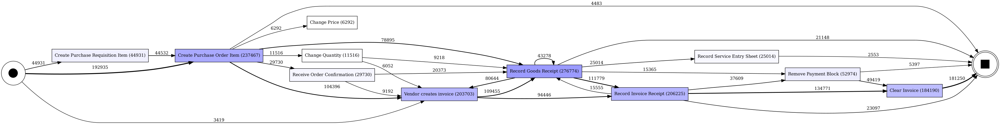
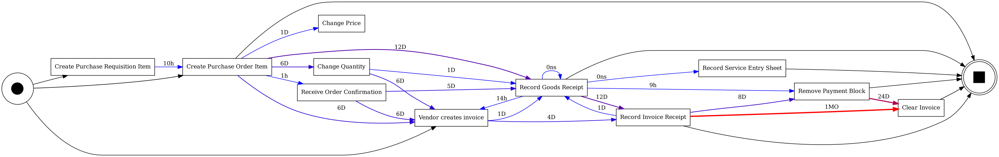
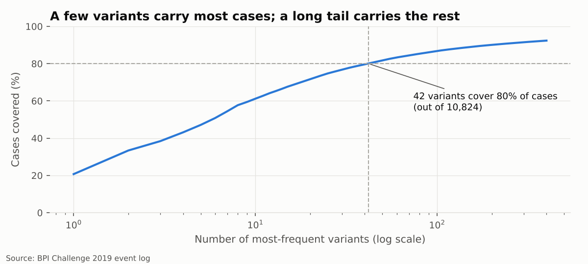
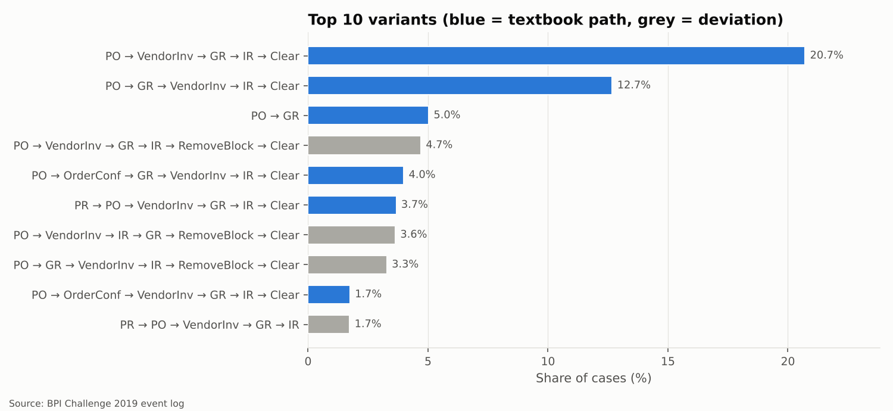
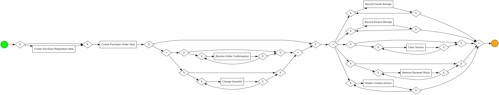

# 2 · AS-IS discovery: the process as it really runs

> **Question.** What does purchase-to-pay actually look like when we let the system logs
> speak, instead of the procedure manual?

Scope: 243,096 non-cancelled cases, 1,438,148 events, 42
distinct activities.

## The directly-follows graph

Each box is an activity; each arrow means "this happened right after that" in at least 2% of
cases. Rarer activities and paths are hidden for readability (the full graph, with
458 arrows, is in `results/discovery/dfg_edges.csv`).

**By frequency** - how many times each hand-over happened:

**By time** - the median waiting time on each hand-over (darker/red = slower):

Where the waiting adds up (all cases, all hand-overs - *total* waiting, not the median, is
what tells you where capacity is consumed):

| From | To | Times | Median wait (days) | Total waiting (case-days) |
| --- | --- | --- | --- | --- |
| Record Invoice Receipt | Clear Invoice | 134,771 | 36.1 | 5,897,700.0 |
| Record Goods Receipt | Record Invoice Receipt | 111,779 | 12.8 | 2,421,080.0 |
| Remove Payment Block | Clear Invoice | 49,419 | 25.0 | 1,795,297.0 |
| Create Purchase Order Item | Vendor creates invoice | 104,396 | 6.5 | 1,244,901.0 |
| Create Purchase Order Item | Record Goods Receipt | 78,895 | 12.1 | 1,189,106.0 |
| Vendor creates invoice | Record Invoice Receipt | 94,446 | 4.7 | 1,182,542.0 |

## Variants: the happy path versus reality

A *variant* is a unique sequence of activities. The log contains **10,824
variants**; 8,033 of them occur exactly once.
**42 variants are enough to cover 80% of cases** - the remaining 20%
of cases are spread over more than ten thousand one-off paths.

The single most frequent path - *PO → Vendor invoice → GR → IR → Clear* - covers only
**20.7%** of cases. Allowing for legitimate options (a requisition
first, an order confirmation, the vendor invoice dated before or after the goods receipt), the
*textbook* path covers **60.6% of completed cases**. The
other 39.4% took a detour: a payment block, a price or
quantity change, a cancelled invoice, a second goods receipt.

| # | Variant | Cases | Share | Cumulative | Textbook? |
| --- | --- | --- | --- | --- | --- |
| 1 | PO → Vendor invoice → GR → IR → Clear | 50,355 | 20.7% | 20.7% | yes |
| 2 | PO → GR → Vendor invoice → IR → Clear | 30,823 | 12.7% | 33.4% | yes |
| 3 | PO → GR | 12,223 | 5.0% | 38.4% | yes |
| 4 | PO → Vendor invoice → GR → IR → Remove block → Clear | 11,432 | 4.7% | 43.1% | no |
| 5 | PO → Order conf. → GR → Vendor invoice → IR → Clear | 9,696 | 4.0% | 47.1% | yes |
| 6 | PR → PO → Vendor invoice → GR → IR → Clear | 8,935 | 3.7% | 50.8% | yes |
| 7 | PO → Vendor invoice → IR → GR → Remove block → Clear | 8,845 | 3.6% | 54.4% | no |
| 8 | PO → GR → Vendor invoice → IR → Remove block → Clear | 7,988 | 3.3% | 57.7% | no |
| 9 | PO → Order conf. → Vendor invoice → GR → IR → Clear | 4,246 | 1.8% | 59.5% | yes |
| 10 | PR → PO → Vendor invoice → GR → IR | 4,215 | 1.7% | 61.2% | no |

Textbook adherence by item category (completed cases):

| Item category | Complete cases | Followed the textbook path |
| --- | --- | --- |
| 2-way match | 301 | 0.0% |
| 3-way match, invoice after GR | 9,654 | 42.8% |
| 3-way match, invoice before GR | 173,588 | 60.0% |
| Consignment | 13,458 | 82.4% |

The 2-way-match category never follows the textbook path: it is dominated by *Change Approval
for Purchase Order* and by invoices that exist before the order - a small but structurally
different process.

## Discovered model (Inductive Miner)

Inductive Miner (infrequent variant, noise threshold 0.2) on the
9 activities that occur in at least
5% of cases (they carry 93.2% of all
events). BPMN file: [`models/as_is_inductive_core.bpmn`](https://github.com/juansanchezalcantara20-ai/p2p-process-mining/blob/main/models/as_is_inductive_core.bpmn).

| Model | Activities | Log fitness | Fitting traces | Precision (5,000 cases) |
| --- | --- | --- | --- | --- |
| Core activities (≥ 5% of cases) | 9 | 0.975 | 82.8% | 0.688 |
| All activities | 42 | 0.983 | 75.3% | 0.233 |

**How to read it.** Fitness says how much of the observed behaviour the model can replay;
precision says how little *unobserved* behaviour it allows. Adding all 42
activities barely improves fitness but collapses precision: the model becomes a "flower" that
permits almost anything. The core model is the honest AS-IS picture: after the purchase order,
goods receipt, vendor invoice, invoice receipt, payment-block removal and clearing run
**in parallel and can repeat**. In other words, the company has no enforced sequence between
receiving goods and paying for them - which is exactly what phase 4 tests as compliance.
