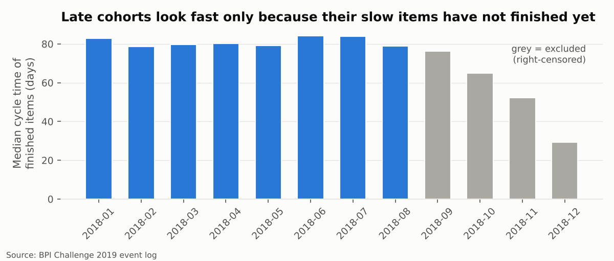
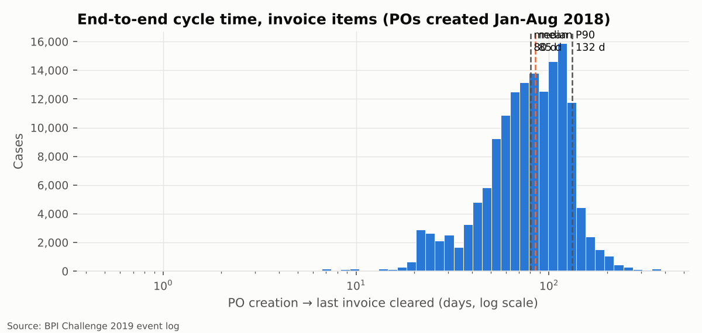
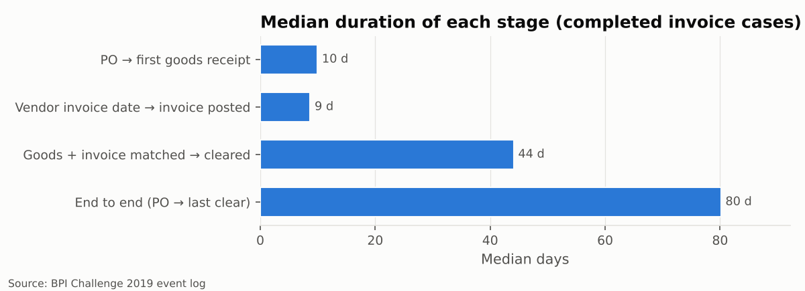
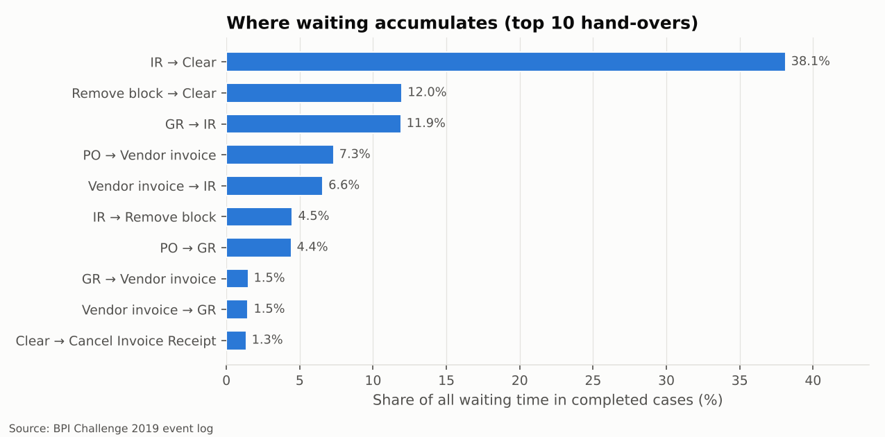
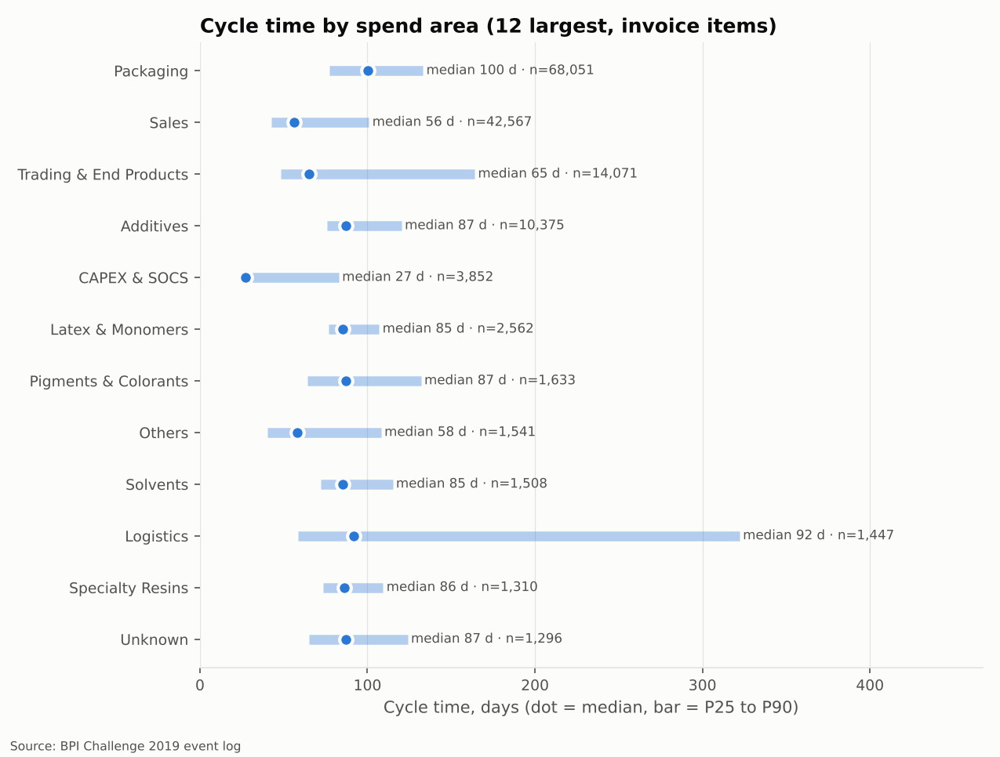
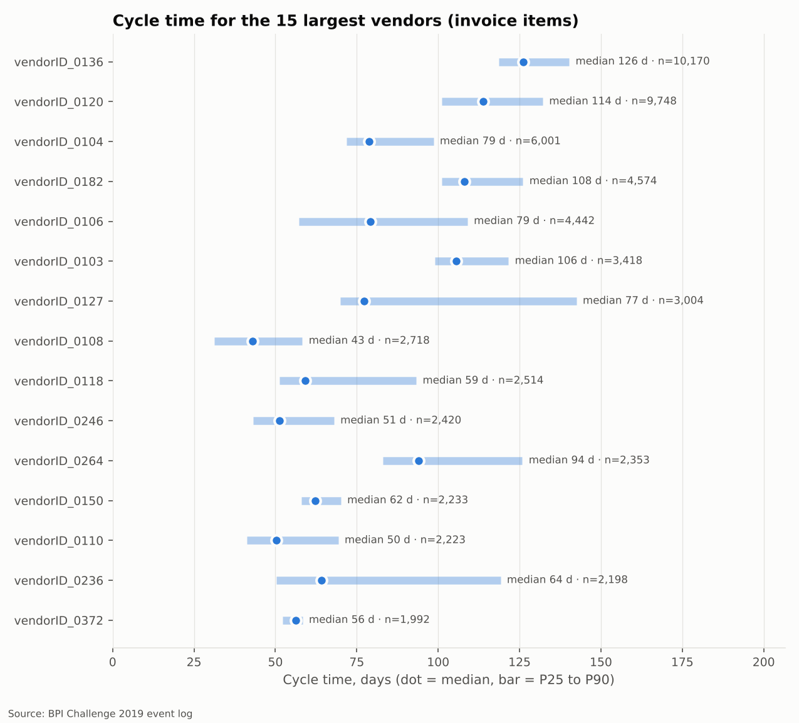

# 3 · Performance and bottlenecks

> **Question.** How long does it take to go from a purchase order to a paid invoice, where
> does the time go, and for whom is it worse?

## Measuring honestly

**Only finished cases from a mature cohort are timed.** A case still open at extraction has
no end date, so it cannot be timed - but excluding it is not neutral either: for orders
created late in 2018 only the *fast* items had finished, so they look artificially quick.

We therefore time purchase orders created between **2018-01-01 and 2018-09-01**
(exclusive), when ~90% of items had finished. That leaves
**162,581 complete cases** (152,655 invoice items) out of
197,001 complete cases in total.

**Medians and percentiles, not averages.** Durations cannot go below zero but can run for a
year, so a few extreme cases drag the mean away from the typical case. The median is what a
typical item experiences; P90 is what the unlucky tenth experiences, and is the number a
supplier complains about. Each stage below shows the gap: invoice capture has a median of
8.7 days but a mean of 18.6 days - a mean would
double the apparent problem for most items while hiding how bad the tail really is.

## Cycle time

Invoice items: **median 80 days** from PO creation to the last invoice cleared,
P25 57, P75 111, **P90 132 days** (mean 85.0).
Consignment items (no invoice per item): median 21 days to the last goods
receipt, P90 49.

| Item category | Cases | Median (days) | P90 (days) | Mean (days) |
| --- | --- | --- | --- | --- |
| 3-way match, invoice before GR | 144,342 | 80.1 | 132.1 | 84.6 |
| Consignment | 9,926 | 20.8 | 49.1 | 24.8 |
| 3-way match, invoice after GR | 8,176 | 83.5 | 135.0 | 93.0 |
| 2-way match | 137 | 7.9 | 89.3 | 32.0 |

## Where the time goes

| Stage | Median (days) | P90 (days) | Mean (days) |
| --- | --- | --- | --- |
| PO → first goods receipt | 9.9 | 33.7 | 15.3 |
| Vendor invoice date → invoice posted | 8.7 | 48.5 | 18.6 |
| Goods + invoice matched → cleared | 44.1 | 98.7 | 49.8 |
| End to end (PO → last clear) | 80.1 | 132.2 | 85.0 |

**The bottleneck is after the goods and the invoice are both in.** The stage from "goods
received and invoice posted" to "invoice cleared" takes a median of
**44 days - more than half of the end-to-end time**. Receiving goods
(10 days median) and capturing invoices (9 days) are
comparatively quick.

The single hand-over *Record Invoice Receipt → Clear Invoice* holds
**38.1% of all waiting time** (median 38 days);
the top three hand-overs hold 62.0%. Two of the top six involve the
payment block.

**Payment blocks.** 27.6% of invoice items had a payment block removed
before clearing. Their median cycle time is **93 days versus
77 without** a block; from invoice receipt to clearing they take a
median 55 days versus 41.

!!! note "Caveat - some waiting is by design"
    The log has no payment-term or due-date field. Part of the invoice-to-clearing time is
    almost certainly deliberate (paying on agreed terms, e.g. 30-60 days, protects working
    capital). The improvement case in phase 6 therefore targets the *excess* over a term
    assumption and the waiting caused by blocks, not all of it.

## Who is affected

The slowest large spend area is **Packaging** (median 100 days,
68,051 cases); the fastest is **CAPEX & SOCS** (median
27 days). Logistics has an unusually long tail (see its P90).

Among the 15 largest vendors, medians range from **43 to
126 days** - a threefold spread for the same company and the same
process, which points at vendor-specific practices (invoice timing, partial deliveries,
blocks) rather than at the process design.

| Document type | Cases | Median (days) | P90 (days) |
| --- | --- | --- | --- |
| Standard PO | 151,263 | 80.2 | 132.0 |
| EC Purchase order | 919 | 67.2 | 168.3 |
| Framework order | 473 | 163.0 | 365.0 |

Framework orders (call-offs against a long-running contract) are structurally long; they
should be tracked against their own target, not the standard-PO target.
