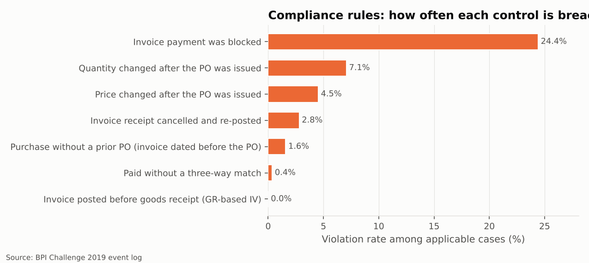
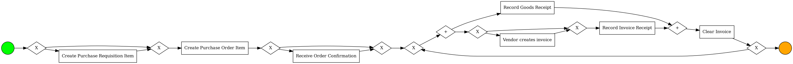
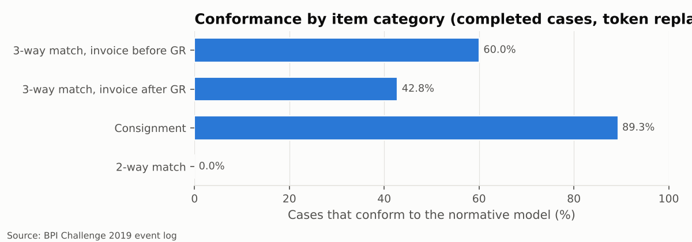

# 4 · Compliance and conformance

> **Question.** Does the process follow the controls a purchase-to-pay process is supposed to
> have - and when it does not, which deviations matter most?

## Two lenses

1. **Business rules** - seven classic P2P controls checked case by case.
2. **Model-based conformance** - every case replayed against an *expected* (normative) model
   for its item category, using token-based replay; optimal alignments on a random subset of
   2,995 cases show *where* cases depart from it.

## Business rules

| Rule | Control tested | Applies to |
| --- | --- | --- |
| Paid without a three-way match | An item requiring 3-way match is cleared only after both a goods receipt and an invoice receipt exist. | 3-way match items that reached Clear Invoice |
| Invoice posted before goods receipt (GR-based IV) | Items flagged 'invoice after GR' must not have the invoice posted before the goods are received. | 3-way match, invoice after GR |
| Price changed after the PO was issued | Prices are agreed before ordering; a change after the PO is rework. | all items |
| Quantity changed after the PO was issued | Quantities are agreed before ordering; a change after the PO is rework. | all items |
| Invoice payment was blocked | A matched invoice flows to payment without manual block/release. | invoice items |
| Purchase without a prior PO (invoice dated before the PO) | No purchase without a purchase order: the vendor invoice date must not precede PO creation. | invoice items |
| Invoice receipt cancelled and re-posted | An invoice is posted once, correctly. | invoice items |

**32.6% of non-cancelled cases breach at least one rule.**
Ranked by impact - number of cases, PO value exposed and excess cycle time versus comparable
cases of the same item category that did *not* breach the rule (each dimension ranked, then
averaged, so no hidden weights):

| Rank | Deviation | Cases | Rate | PO value affected (EUR M) | Extra median days vs peers | Excess case-days |
| --- | --- | --- | --- | --- | --- | --- |
| 1 | Invoice payment was blocked | 55,909 | 24.4% | 272.8 | 16.2 | 682,061 |
| 2 | Quantity changed after the PO was issued | 17,194 | 7.1% | 104.0 | 23.9 | 287,875 |
| 3 | Price changed after the PO was issued | 11,005 | 4.5% | 130.5 | 18.3 | 143,454 |
| 4 | Invoice receipt cancelled and re-posted | 6,414 | 2.8% | 104.3 | 31.4 | 158,425 |
| 5 | Purchase without a prior PO (invoice dated before the PO) | 3,616 | 1.6% | 41.2 | -41.2 | -92,628 |
| 6 | Paid without a three-way match | 657 | 0.4% | 1.7 | -16.9 | -8,638 |
| 7 | Invoice posted before goods receipt (GR-based IV) | 0 | 0.0% | 0.0 | n/a | 0 |

How to read the ranking:

* **Payment blocks are the dominant deviation**: 55,909 invoice items
  (24.4%), EUR 273 M of PO value, and a median
  of 16.2 extra days compared with unblocked peers.
* **Rework after ordering** (quantity and price changes) is next: the order was issued before
  the commercial terms were settled.
* **The GR-based invoice-verification control works**: 0 of
  14,839 items flagged *invoice after GR* had the invoice posted before
  the goods. The system enforces it - a useful contrast with the rules that rely on people.
* **After-the-fact purchasing** (3,616 cases, EUR
  41 M) and **payment without a complete three-way match**
  (657 cases) are *faster* than their peers. They are not time
  problems; they are **control** problems - the speed comes precisely from skipping the
  control. Their priority comes from audit risk, not from waiting time.

## Conformance against the expected model

The expected model for the dominant category (*3-way match, invoice before GR*): optional
requisition and order confirmation, then - per delivery - the goods receipt in parallel with
the vendor invoice and invoice posting, and clearing only once both are in.

Normative BPMN files for all four categories are in `models/normative_*.bpmn`.

**61.1% of completed cases conform** to their expected model
(mean trace fitness 0.988); 36.2%
contain at least one activity the expected model does not foresee. Across *all* non-cancelled
cases the figure is 49.5%, because open cases have not reached
clearing yet.

| Item category | Completed cases | Conforming | Mean trace fitness |
| --- | --- | --- | --- |
| 2-way match | 301 | 0.0% | 0.9 |
| 3-way match, invoice after GR | 9,654 | 42.8% | 0.9 |
| 3-way match, invoice before GR | 173,588 | 60.0% | 1.0 |
| Consignment | 13,458 | 89.3% | 1.0 |

Where the alignments locate the deviations (moves summed over the aligned subset):

| Move type | Activity | Moves |
| --- | --- | --- |
| log move (extra, not in model) | Remove Payment Block | 698 |
| model move (expected, missing) | Clear Invoice | 567 |
| log move (extra, not in model) | Record Goods Receipt | 441 |
| log move (extra, not in model) | Record Service Entry Sheet | 381 |
| log move (extra, not in model) | Change Quantity | 286 |
| model move (expected, missing) | Record Invoice Receipt | 231 |
| log move (extra, not in model) | Change Price | 162 |
| log move (extra, not in model) | Vendor creates invoice | 125 |

*Log moves* are steps that happened but should not have (payment-block removals, extra goods
receipts and service-entry sheets, changes); *model moves* are steps the model expected but
that never happened (mostly clearing in items that were never paid in full, and missing
invoice receipts).

The 2-way-match category conforms 0%: every one of its cases carries *Change Approval for
Purchase Order*, which the expected model does not contain. Either the expected model is
wrong for this category (approval changes are its normal practice) or the practice is; this
is a question for the process owner, not something the data can settle.
