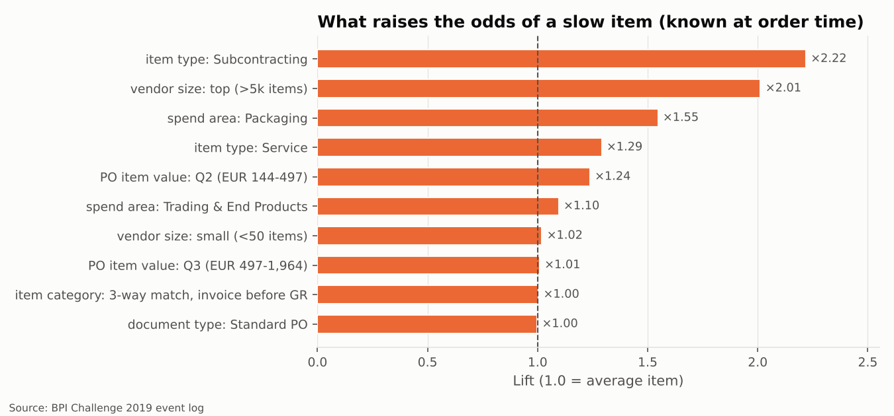
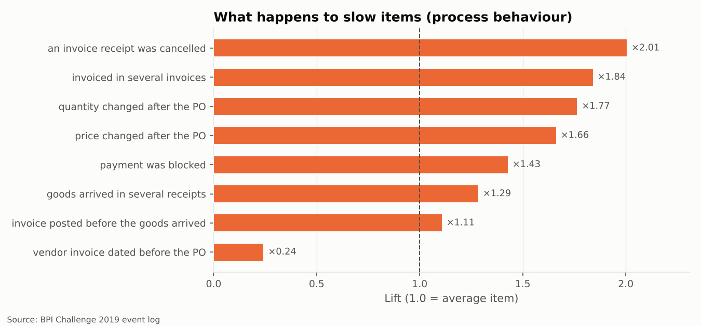

# 5 · Root cause: what goes with slow items and deviations?

> **Question.** Which characteristics of a purchase-order item make it more likely to be
> slow, or to break a control? And what happens to the slow ones along the way?

**Definitions.** A *slow* item is a completed invoice item in the top quartile of cycle time:
more than **111 days** from PO to payment (mature cohort,
152,655 items, so 25% are slow by construction). A
*deviating* item breaks at least one of the phase-4 rules (34.9% of completed
items).

**Method, in plain words.** For every attribute value we compare the share of slow items with
the average (*lift*: ×2.0 means "twice as likely as a typical item"). Then a three-question
decision tree finds the combinations that separate slow from normal items best. Three
questions is deliberately few: every branch can be read aloud and checked by the process
owner. We keep **order-time attributes** (known when the PO is raised) separate from
**process behaviours** (what happens afterwards), because the latter are partly a consequence
of slowness rather than a cause.

## 1. Who is slow? (order-time attributes)

| Attribute | Value | Items | Rate | Lift |
| --- | --- | --- | --- | --- |
| item type | Subcontracting | 1,540 | 55.5% | ×2.22 |
| vendor size | top (>5k items) | 38,353 | 50.3% | ×2.01 |
| spend area | Packaging | 68,051 | 38.7% | ×1.55 |
| item type | Service | 2,138 | 32.3% | ×1.29 |
| PO item value | Q2 (EUR 144-497) | 41,705 | 30.9% | ×1.24 |
| spend area | Trading & End Products | 14,071 | 27.4% | ×1.10 |

The tree's answer:

| If... | Items | Flagged rate | vs average |
| --- | --- | --- | --- |
| vendor size is top (>5k items) AND PO item value is Q1 (< EUR 144) or Q2 (EUR 144-497) | 21,714 | 63.5% | ×2.54 |
| vendor size is top (>5k items) AND PO item value is Q3 (EUR 497-1,964) | 10,619 | 42.6% | ×1.70 |
| spend area is not Sales AND vendor size is not top (>5k items) AND PO item value is not Q1 (< EUR 144) | 60,604 | 23.6% | ×0.95 |
| vendor size is top (>5k items) AND PO item value is Q4 (> EUR 1,964) | 6,020 | 16.2% | ×0.65 |
| spend area is not Sales AND vendor size is not top (>5k items) AND PO item value is Q1 (< EUR 144) | 11,131 | 8.5% | ×0.34 |
| spend area is Sales AND vendor size is not top (>5k items) AND PO item value is Q1 (< EUR 144) | 12,076 | 3.9% | ×0.16 |

**In business language:** *low-value items bought from the very largest vendors are the slow
ones.* The segment "top vendor (> 5,000 items in the log) and item value below EUR 500" holds
**21,714 items from just 6 vendors**, 100%
of them in Packaging. **64% of them are slow, against
19% for everything else.**

Where their time goes:

| | Hotspot (6 vendors) | All other items |
| --- | --- | --- |
| Items | 21,714 | 130,941 |
| Median cycle time | 115 days | 73 days |
| Median PO → goods receipt | 14 days | 9 days |
| **Median matched → cleared** | **97 days** | 37 days |
| Payment-block share | 31.7% | 27.0% |

Delivery is only a few days slower; the difference is almost entirely **after the invoice is
matched**. Two explanations fit the data and the data alone cannot choose between them:
(a) these vendors invoice many small items that are paid in a periodic batch or under a long
agreed payment term, or (b) small-value invoices from big vendors are deprioritised in
accounts payable. Both are worth checking with AP, and both point to the same remedies:
consolidated or self-billing invoicing (evaluated receipt settlement) for high-volume,
low-value lines - see phase 6.

Tree quality on a 30% hold-out: balanced accuracy 0.68,
ROC AUC 0.75. That is a useful *signal*, not a forecast:
order-time attributes explain part of the slowness, the rest happens during execution.

## 2. What happens to slow items? (process behaviour)

| Attribute | Value | Items | Rate | Lift |
| --- | --- | --- | --- | --- |
| an invoice receipt was cancelled | yes | 5,055 | 50.2% | ×2.01 |
| invoiced in several invoices | yes | 7,892 | 46.1% | ×1.84 |
| quantity changed after the PO | yes | 11,244 | 44.1% | ×1.77 |
| price changed after the PO | yes | 7,837 | 41.6% | ×1.66 |
| payment was blocked | yes | 42,203 | 35.7% | ×1.43 |
| goods arrived in several receipts | yes | 6,356 | 32.2% | ×1.29 |

| If... | Items | Flagged rate | vs average |
| --- | --- | --- | --- |
| payment was blocked AND quantity changed after the PO AND goods arrived before the invoice was posted | 2,850 | 52.5% | ×2.10 |
| no payment block AND quantity changed after the PO | 7,411 | 41.4% | ×1.66 |
| no payment block AND no quantity change AND invoiced in several invoices | 3,175 | 39.2% | ×1.57 |
| payment was blocked AND no quantity change AND goods arrived before the invoice was posted | 26,873 | 37.5% | ×1.50 |
| payment was blocked AND invoice posted before the goods arrived | 12,480 | 28.1% | ×1.13 |
| no payment block AND no quantity change AND a single invoice | 99,866 | 18.8% | ×0.75 |

Items with **none** of these behaviours (60.8% of the cohort) take a
median of **73 days**. Each behaviour adds time:

| Behaviour | Share of items | Median cycle (days) |
| --- | --- | --- |
| invoice cancelled | 3.3% | 111.0 |
| multiple invoices | 5.2% | 105.3 |
| quantity change | 7.4% | 104.2 |
| price change | 5.1% | 98.0 |
| payment block | 27.6% | 93.1 |
| multiple goods receipts | 4.2% | 91.9 |
| invoice before goods | 8.4% | 80.3 |
| after the fact po | 1.5% | 37.2 |

**In business language:** a quantity change after the order and a payment block are the two
behaviours most associated with slowness; items that hit both are slow
52% of the time. Vendor invoices dated before the PO are fast
(the work was already done when the PO was raised) - a control issue, not a speed issue.

## 3. Who deviates? (order-time attributes)

| Attribute | Value | Items | Rate | Lift |
| --- | --- | --- | --- | --- |
| spend area | Trading & End Products | 17,013 | 47.1% | ×1.35 |
| PO item value | Q4 (> EUR 1,964) | 48,503 | 44.7% | ×1.28 |
| spend area | Latex & Monomers | 4,199 | 41.7% | ×1.20 |
| vendor size | small (<50 items) | 10,440 | 40.7% | ×1.17 |
| spend area | CAPEX & SOCS | 5,302 | 39.3% | ×1.13 |
| PO item value | Q3 (EUR 497-1,964) | 49,399 | 38.7% | ×1.11 |

| If... | Items | Flagged rate | vs average |
| --- | --- | --- | --- |
| item category is not Consignment AND spend area is not Sales AND PO item value is not Q1 (< EUR 144) | 107,848 | 42.2% | ×1.21 |
| item category is 2-way match or 3-way match, invoice after GR AND spend area is Sales | 2,291 | 41.7% | ×1.20 |
| item category is 3-way match, invoice before GR AND spend area is Sales | 53,253 | 28.8% | ×0.83 |
| item category is not Consignment AND spend area is not Sales AND PO item value is Q1 (< EUR 144) | 20,151 | 28.6% | ×0.82 |
| item category is Consignment AND spend area is not Additives / Packaging | 3,033 | 9.1% | ×0.26 |
| item category is Consignment AND spend area is Packaging | 8,019 | 6.8% | ×0.20 |

Deviations are spread widely (hold-out ROC AUC 0.60): no single
segment owns them, apart from consignment, which almost never deviates because it has no
invoice step. Higher-value items and *Trading & End Products* deviate more often - consistent
with more negotiation (price and quantity changes) on larger purchases.

!!! warning "Association, not causation"
    These are patterns in historical data. They tell the improvement team *where to look* and
    *which hypotheses to test*; they do not prove that changing an attribute would change the
    outcome. Each hypothesis above is phrased so it can be checked with the process owner.
