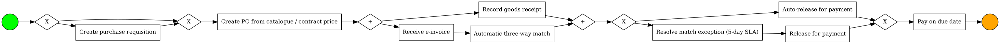
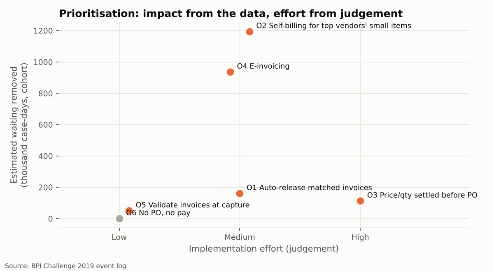

# 6 · TO-BE process and improvement case

> **Question.** What should the process look like, which changes come first, and how much
> waiting would they remove - according to the company's own data?

!!! warning "Estimates, not savings"
    Every figure on this page is an **estimate derived from the AS-IS event log under the
    assumption written next to it**. Nothing here has been implemented or measured after a
    change. Base: 152,655 completed invoice items from POs created
    2018-01-01 - 2018-09-01 (exclusive), i.e. eight months of orders.

## TO-BE process

What changes against the AS-IS model of phase 2:

| AS-IS (observed) | TO-BE (designed) |
| --- | --- |
| Goods receipt, invoice, block removal and clearing run in any order and repeat | Goods receipt in parallel with e-invoice → automatic three-way match; clearing only after the match |
| 29.0% of 3-way items need a manual block release or an invoice re-posting | Auto-release inside tolerance; a named owner resolves exceptions within 5 days |
| Price and quantity changed after the PO in 14.1% of items (incl. invoice cancellations) | PO created from catalogue / contract price; requester confirms quantity before release |
| Paper / PDF invoices posted a median 9 days (P90 48) after their date | Structured e-invoice, posted on receipt |
| Small items from the largest vendors wait ~101 days from invoice date to payment | Self-billing (ERS) or one consolidated invoice per period ([`models/to_be_ers_variant.bpmn`](https://github.com/juansanchezalcantara20-ai/p2p-process-mining/blob/main/models/to_be_ers_variant.bpmn)) |
| Invoices dated before the PO accepted | "No PO, no pay"; fast-track PO or purchasing card for urgent buys |

BPMN: [`models/to_be.bpmn`](https://github.com/juansanchezalcantara20-ai/p2p-process-mining/blob/main/models/to_be.bpmn).

## Prioritised opportunities

| Priority | Opportunity | Items improved | Waiting removed (case-days) | Median saving per item (days) | Median cycle if done alone | Effort |
| --- | --- | --- | --- | --- | --- | --- |
| 1 | **O2** Self-billing / consolidated invoicing for high-volume, low-value lines | 20,775 | 1,193,897 | 60.5 | 69.4 | Medium |
| 2 | **O4** E-invoicing to cut invoice capture time | 60,684 | 935,523 | 8.6 | 73.1 | Medium |
| 3 | **O1** Auto-release matched invoices (remove avoidable payment blocks) | 13,395 | 160,438 | 13.9 | 79.2 | Medium |
| 4 | **O5** Validate invoices at capture (fewer cancellations and re-postings) | 1,790 | 49,663 | 26.9 | 80.0 | Low |
| 5 | **O3** Settle price and quantity before the PO is issued | 6,128 | 112,543 | 21.7 | 79.2 | High |
| 6 | **O6** Enforce 'no PO, no pay' (after-the-fact purchasing) | 2,355 | 0 | 0.0 | 80.1 | Low |

Priority = waiting removed ÷ effort (Low 1, Medium 2, High 3). Effort is a judgement call and
is labelled as such; impact comes from the data. **O6** removes no waiting - its case is
control: 2,355 items in the cohort, EUR 29.8 M of PO value bought before a PO existed.

### The assumption behind every number

| # | Lever | Assumption behind the estimate | KPI it moves |
| --- | --- | --- | --- |
| **O2** | Evaluated receipt settlement (pay on goods receipt, no vendor invoice) or one consolidated invoice per period for the largest vendors' small items. | For items from vendors with > 5,000 items in the log and value below EUR 500 (the root-cause hotspot), matched-to-cleared time falls to the median of all other items. If the long wait is a contractual payment term, the time and cash impact is zero and only the administrative saving remains - verify terms first. | Cycle time, on-time payment |
| **O4** | Structured e-invoices / OCR with automatic posting. | Capture time (vendor invoice date → invoice posted) falls to at most 3 days. The data show that payment is anchored on the vendor's invoice date, not on the posting date, so faster capture only helps items that were paid later than the assumed 60-day term: the saving is the smaller of (capture time beyond target) and (days paid beyond the term). | Cycle time |
| **O1** | Tolerance-based automatic three-way match; blocks only for true exceptions; daily exception queue with an owner and a 5-day SLA. | Half of today's payment blocks are avoidable (e.g. small price/quantity differences inside a tolerance). For each avoided block the item loses its excess matched-to-cleared time over unblocked items of the same category, capped at the category's median excess. | First-pass match rate, cycle time |
| **O5** | Mandatory PO reference and line validation before posting. | Half of invoice cancellations are preventable; each removes the item's excess cycle time over items without cancellation, capped at the category median excess. | Rework rate, first-pass match rate |
| **O3** | Catalogue/contract prices in the PO, quantity confirmation from the requester, PO approval checks the price against the contract. | Half of post-PO price/quantity changes are preventable. Each prevented change removes the item's excess cycle time over unchanged items of the same category, capped at the category's median excess. | Rework rate, cycle time |
| **O6** | Reject invoices without a prior PO; route urgent buys through a fast-track PO or procurement card. | Control and audit-risk improvement. These items are faster than peers, so no cycle-time saving is claimed; the impact is the PO value bought outside the control. | Compliance (after-the-fact rate) |

### Why e-invoicing is estimated conservatively

A naive estimate would credit every day of faster invoice capture as a day of faster payment.
The data say otherwise: **payment is anchored on the vendor's invoice date**, not on the day
the invoice is posted. The later an invoice is posted, the *shorter* the wait between posting
and payment - the total from invoice date to payment barely moves until capture becomes very
slow:

| Invoice capture time (days) | Items | Median invoice date → cleared | Median posting → cleared |
| --- | --- | --- | --- |
| 0-2 | 31,443 | 76.8 | 76.0 |
| 3-5 | 23,592 | 69.4 | 65.9 |
| 6-10 | 25,578 | 56.6 | 49.2 |
| 11-20 | 23,204 | 55.8 | 42.7 |
| 21-40 | 26,781 | 56.6 | 27.0 |
| >40 | 21,710 | 82.7 | 19.9 |

So O4 only claims time for invoices that were posted so late that payment slipped past the
assumed 60-day term. The same evidence warns about O2: the
hotspot's small items are paid a median 101 days
after their invoice date versus 62 for everything
else. If that reflects an agreed 90-day term, O2's time and cash effect is zero and only the
administrative saving (thousands fewer invoices to match) remains. **Check the contracts
before committing to O2's number.**

## What the improved process would look like in numbers

Simulation: for each opportunity, the assumed avoidable share of affected items (seeded
random draw) loses its excess time over comparable peers; savings are summed per item and the
new cycle time is never shorter than the item's own delivery time.

| KPI | AS-IS baseline | TO-BE estimate |
| --- | --- | --- |
| Median cycle time (days) | 80.1 | 63.3 |
| P90 cycle time (days) | 132.2 | 107.7 |
| Rework rate | 14.1% | 9.0% |
| First-pass three-way match | 71.0% | 80.7% |
| Paid within 60 days of invoice date | 42.8% | 76.8% |

Combined, the levers remove an estimated **2,428,296 case-days** of
waiting over eight months of orders (the sum of the individual estimates,
2,452,065, overlaps slightly because some items benefit from
several levers). These targets feed the control dashboard in the DMAIC chapter.

On-time payment depends heavily on the assumed term (no due-date field exists in the log):
the share of items paid within 30 / 45 / 60 / 90 days of the invoice date is
10% / 22% / 43% / 76%.
