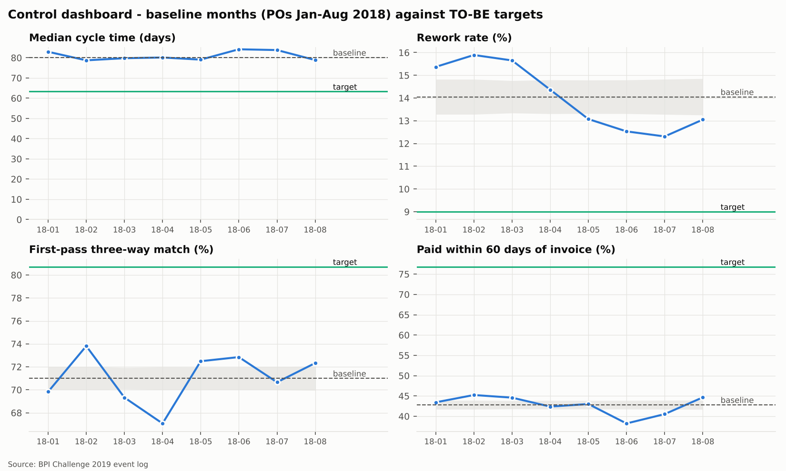

# 7 · DMAIC: the improvement case end to end

The analysis above, organised as a Lean Six Sigma DMAIC project.

## Define

**Problem statement.** Purchase-order items take a median of **80
days** (P90 132) from order to payment; only
**42.8%** of invoices are paid within 60 days of their date, and
**29.0%** of three-way-match items need manual intervention
(payment block or invoice re-posting) before they can be paid.

**Goal.** Reduce median order-to-payment time towards **63 days** and
raise first-pass match to **81%**, without weakening controls.

**Scope.** Purchase-order items (one case = one PO item) of the four item categories, from
requisition/PO creation to invoice clearing. Out of scope: sourcing, contract negotiation,
treasury decisions on payment runs.

**CTQs (critical to quality).** Order-to-payment time; on-time payment to suppliers; first-pass
three-way match; no purchase without a PO.

**SIPOC**

| Suppliers | Inputs | Process | Outputs | Customers |
| --- | --- | --- | --- | --- |
| Requesters, vendors, contract owners | Requisition, PO data, goods, vendor invoice | Requisition → PO → goods receipt → invoice receipt → match → clear | Paid, correctly matched invoice; received goods | Vendors, requesters, finance / AP, auditors |

## Measure

* Data: 1,595,923 events, 251,734 cases - the
  complete BPI Challenge 2019 log, checked and cleaned with a written trail
  ([phase 1](01-data-quality.md)).
* Baseline (mature cohort, POs Jan-Aug 2018): median cycle 80.1 days,
  P90 132.2; rework 14.1%; first-pass three-way match
  71.0%; paid within 60 days 42.8%.
* Measurement-system notes: three activities are date-only; no due-date field (on-time KPI
  uses an assumed term); late cohorts are right-censored and excluded from timing.

## Analyze

* **Flow** ([phase 2](02-discovery.md)): 10,824 variants; 42
  cover 80% of cases; only 60.6% of completed cases follow
  the textbook path.
* **Bottleneck** ([phase 3](03-performance.md)): the stage after goods and invoice are both in
  takes a median 44 days - over half of the cycle; *invoice receipt → clear* alone holds
  38.1% of all waiting.
* **Compliance** ([phase 4](04-conformance.md)): 61.1% of completed
  cases conform to the expected model; payment blocks are the highest-impact deviation.
* **Root cause** ([phase 5](05-root-cause.md)): low-value items from the 6
  largest vendors are slow 64% of the time; quantity changes and payment
  blocks are the process behaviours most associated with delay.

## Improve

Six prioritised levers and the TO-BE process ([phase 6](06-to-be.md)). Suggested sequencing:

1. **Quick wins (0-3 months):** O5 invoice validation at capture, O6 "no PO, no pay",
   contract check for the hotspot vendors (decides O2).
2. **Core (3-9 months):** O1 tolerance-based auto-release, O4 e-invoicing, O2 self-billing pilot
   with one hotspot vendor.
3. **Structural (6-12 months):** O3 catalogue / contract pricing in the PO.

Pilot each lever on one spend area first and compare it with a control group - the event log
makes a before/after comparison cheap.

## Control

The dashboard the process owner would review monthly. Each KPI is computed from fields that
already exist in the event log, so it can be refreshed automatically by this pipeline.

Grey bands are 3-sigma p-chart limits around the baseline proportion: a month outside the band
is a real change, not noise. Shown here on the baseline months, before any change.

| KPI | Definition (from the event log) | Baseline | Target (TO-BE estimate) | Review | Reaction if off-track |
| --- | --- | --- | --- | --- | --- |
| Order-to-payment time | Median days, *Create PO Item* → last *Clear Invoice*, completed invoice items, by PO month | 80.1 d | 63.3 d | Monthly | Drill into the waiting Pareto for the month; check block queue |
| Rework rate | Share of items with *Change Price*, *Change Quantity* or *Cancel Invoice Receipt* after the PO | 14.1% | 9.0% | Monthly | Top spend areas / requesters by changes; refresh catalogue prices |
| First-pass three-way match | Share of 3-way items cleared with no payment block and no invoice cancellation | 71.0% | 80.7% | Weekly | Review block reasons; adjust tolerances |
| On-time payment | Share cleared ≤ 60 days after the vendor invoice date (assumed term) | 42.8% | 76.8% | Monthly | Replace the assumed term with real due dates; review late payments by vendor |
| After-the-fact purchasing (guardrail) | Share of invoice items with vendor invoice dated before the PO | see phase 4 | → 0 | Monthly | Escalate to budget owner |

Targets are the simulated TO-BE values from phase 6 and inherit its assumptions. Speed must not
be bought by weakening control: the after-the-fact guardrail and the three-way-match rule
(phase 4) stay on the dashboard for that reason.
